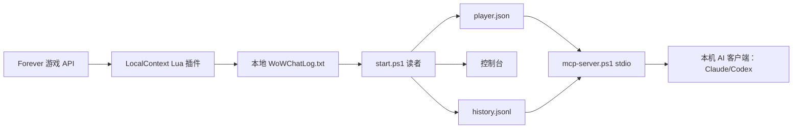

# 当前架构与生命周期

图中没有网络服务。GitHub 是源码与历史交接存档，不参与运行数据流。

## 组件职责

| 文件 | 职责 |
| --- | --- |
| `LocalContext.toc` | 注册插件，Interface 16001，加载 Lua |
| `LocalContext.lua` | 读取 API、组装 JSON、分段发送和分帧填充 |
| `start.bat` | 设控制台代码页，启动 Windows PowerShell，退出后 pause |
| `start.ps1` | 可选复制插件、互斥锁、增量读文件、组装快照、输出和刷新年龄 |
| `mcp-server.ps1` | 只读 MCP 服务器（stdio JSON-RPC），读 player.json/history.jsonl，重新计算新鲜度 |
| `lib/common.ps1` | 共用函数：查找游戏目录、Claude/Codex 配置路径 |
| `check-setup.ps1` / `.bat` | 只读安装检查：游戏目录、插件版本、日志、读者、MCP、客户端配置 |
| `install-mcp.ps1` / `.bat` | 把 mcp-server.ps1 注册到 Claude Desktop 和 Codex 配置；保留其他设置并备份 |
| `docs/ADVISOR.md` | “下一步做什么”的顾问规则；mcp-server.ps1 的 what_next 提示读取其标记之间的正文 |
| `test-reader.ps1` | 在临时目录构造模拟日志，调用实际读者 |
| `tests/test_install_mcp.py` | 用临时配置文件测试 install-mcp.ps1 |
| `tests/test_mcp.py` | 通过 stdio 调用 MCP 服务器的模拟测试 |
| `tests/test_addon.py` | Lua 5.1 模拟 API 环境执行实际插件 |

## 插件生命周期

加载时生成 session：当前 Unix 时间加六位随机数。进入世界设置 active，约 3 秒后尝试采样；另有 15 秒 ticker。离开世界设置 inactive，发送队列会停止。

新快照要求 active、非 busy、非战斗锁定、Interface 恰好 16001，并且 SendSystemMessage 存在。LoggingChat 通过 pcall 开启。序号递增后采集身份，再分别用 pcall 包裹 quests、completedQuests、location、equipment。

分区异常会设置 capability=false 并追加错误，但某些分区可能已写入部分内容；消费者不能把 capability=false 的内容当完整结果。外层采样异常会直接跳过该轮，目前不输出诊断心跳。pcall 成功也不代表 API 返回了完整语义数据。

快照 JSON 编码后转 hex，按段入队，追加 58 条填充，每条正文为 LCB1PAD 加 900 个 z。每帧发送两条。发送期间的 CHAT_MSG_SYSTEM 被过滤，不改变其他聊天的显示逻辑。send 的失败布尔值目前没有用于中断队列或报告错误。

## 读者生命周期

1. 解析参数并确定日志和输出位置。
2. 对完整输出路径做 SHA256，建立 Windows 会话内命名 Mutex；同一会话同一路径的重复读者会退出。
3. 未指定 GameRoot 时自动查找（lib/common.ps1）；未指定 SkipInstall 时确保 Interface\AddOns 存在并复制 LocalContext。当前没有额外读取 build.info 验证目录确为 Forever，插件自身接口门禁承担输出限制。
4. 启动扫描（T1）：从日志末尾取 2 MB 窗口（不够则 ×4 扩大直到文件开头），丢弃窗口首个残行，只保留窗口内最后一个完整快照，扫描期间不发布任何快照、不写历史。之后从文件末尾继续追读，残行和未收齐的分段保留。文件以允许其他进程同时写的模式打开。
5. 每次读取最多 65536 字节，将残行保留到下次读取；完整行按严格前缀格式筛选。
6. 当前只组装一个 session/sequence 的分段集合。收齐后 hex→严格 UTF-8→JSON，检查 schema、character、capturedAt 和键一致性。
7. 写同目录临时文件，再 Move-Item 覆盖输出。未做跨进程读写压力或断电原子性保证。
8. 每发布一个快照，与 history.jsonl 最后一条的摘要比较；等级、区域/子区域、任务增删/进度/完成、装备变化时追加一行，超过 HistoryLimit+50 行时截断到最近 HistoryLimit（默认 500）行。
9. 每 2 秒刷新新鲜度；Once 模式处理当前文件一次即退出；Iterations 用于测试。

文件缩短会重新做启动扫描。读者没有持久化游标，也不会在启动时复用上次 player.json；缺失日志时发布 waiting_for_game。文件的同尺寸快速替换、某些 I/O 异常恢复没有完整实现。

## 状态与失败语义

| 场景 | 当前行为 |
| --- | --- |
| 无日志 | 输出 waiting_for_game，年龄 null、stale=true |
| 尚未收齐快照 | 保留前一个完整状态；无前态时仍 waiting |
| 新鲜完整快照 | snapshot_received，重新计算年龄 |
| 游戏退出/战斗暂停 | 没有新采样；旧数据年龄增加并变 stale |
| 解析失败 | 警告并拒绝该快照，不混入聊天内容 |
| 新 session/sequence | 丢弃尚未收齐的前一组分段 |
| 日志历史很大 | 从末尾扫描，只发布最新完整快照（模拟 10.8 MB 约 0.3 秒） |

当前不会检测游戏进程来声明在线状态。snapshot_received 只说明解析过快照，stale=false 只说明其时间足够近，不是游戏已登录或数据完整的独立证明。
